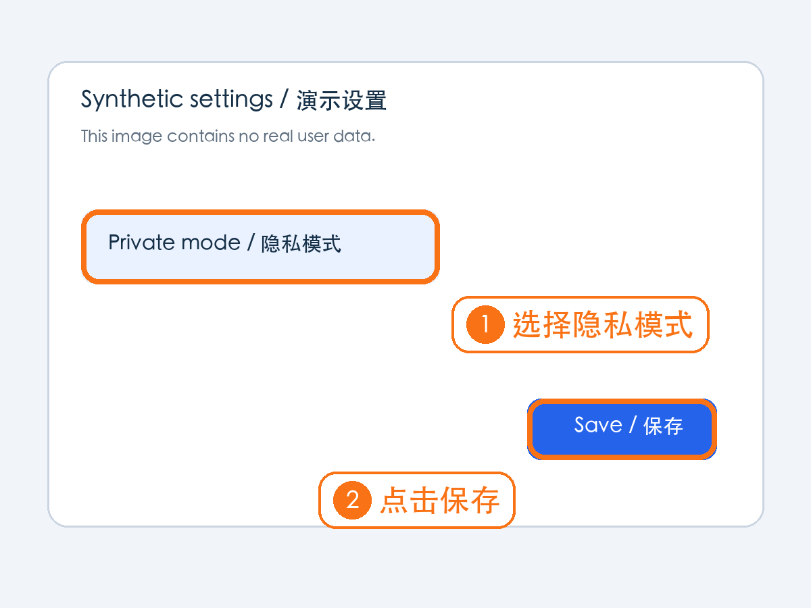
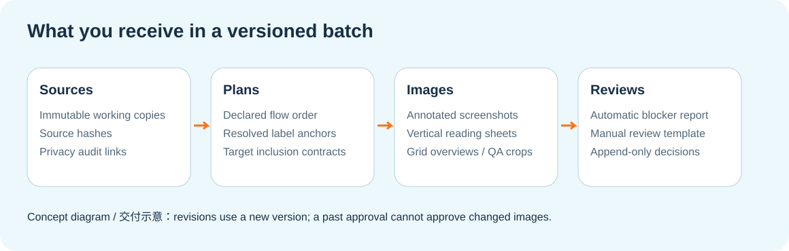
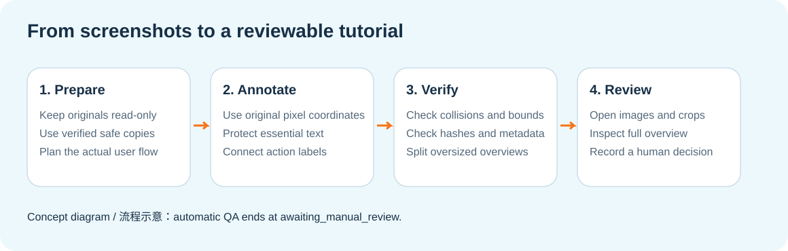

<a id="截图标注-skill"></a>

<div align="center">

# 截图标注 · 教程图与操作指引 Skill

**把点击入口和操作顺序写到图上，便于新手照着做。**

动作标注 · 入口框选 · 教程拼图 · 本地脚本

[](#readme-detail-12)
[](#readme-detail-12)

[✨ 核心特性](#readme-detail-12) · [👀 用自己的截图制作](#readme-detail-14) · [✅ 适用场景](#readme-detail-audience) · [🚀 先运行合成演示](#readme-detail-18) · [🧩 模块速查](#readme-detail-24) · [✅ 典型场景](#readme-detail-20)

</div>

---

[完整 Skill 指令](SKILL.md)


给同事发一张截图，对方可能还要问“到底点哪儿”。这个工具会把动作写到图上，框住完整入口，保护需要阅读的文字，再把多张图按真实操作顺序整理成阅读图。仓库同时提供 AI Agent 的 Skill 和本地 Python 脚本；脚本不需要 AI 密钥，理解页面和确认操作是否正确仍需要人或具备看图能力的 Agent。



这是仓库演示脚本生成的实际结果。页面和数据均为虚构演示，未使用用户截图，也不代表正在运行的产品。

<a id="readme-section-1"></a>

<a id="详细能力清单"></a>

<a id="readme-detail-12"></a>

## ✨ 核心特性

| 能力 | 可以做什么与使用条件 |
|---|---|
| 单图兼容 | v1 红色圆角框、圆形编号和局部 QA |
| 批量版本管理 | 稳定素材 ID、明确顺序、语义文件名、源图副本和独立版本目录 |
| 坐标网格 | 100px 网格帮助读坐标；不会自动理解入口或强制吸附 |
| 动作标注 | v2 橙色或红色圆角框、大字号标签和清楚的连接关系 |
| 顺序与并列 | 单点免编号，真实先后顺序使用数字，可选入口使用字母 |
| 保护区域 | 避开已声明的标题、按钮文字、关键数值等；保护区需要由人或 Agent 提供 |
| 场景目标契约 | 规定按钮、菜单、导航和结果行必须包含或排除哪些区域 |
| 阅读版式 | 纵向长图、4–7 列总览，按像素与可读性预算分片 |
| 自动 QA | 检查越界、碰撞、源图哈希、元数据、允许变化区域和文件一致性 |
| 人工复核 | 按版本绑定复核模板和追加记录，返修不能沿用旧版签核 |
| 隐私继承 | 必要时读取已验证的上游脱敏审计；不会自动识别并遮挡私人信息 |
| 最小返修 | 保留旧版本，只调整失败素材并重新复核 |



<a id="readme-section-2"></a>

<a id="用自己的截图制作"></a>

<a id="readme-detail-14"></a>

## 👀 用自己的截图制作

1. 把截图放入私人工作目录。如果有姓名、账号、地址或业务资料，先制作并验证脱敏副本。
2. 从 `examples/run_demo.py` 的完整案例起步，或调整[批量计划示例](examples/batch-plan-v2.json)。后者引用的原始图片需要自行提供，不能当作现成素材包直接运行。
3. 填好操作顺序、源文件、目标框、需保护的文字区域和标签。坐标使用原始图片像素；若经过授权裁切，必须按裁切后的画布重新计算。
4. 生成、独立校验，再实际查看全部产物。

```bash
python3 scripts/annotate_batch.py --manifest my-plan.json --output-root output
```

已有旧版圆形编号计划时，也可以继续走 v1：

```bash
python3 scripts/annotate_screenshot.py \
  --input source.png --plan examples/annotation-plan.json \
  --output annotated.png --qa-dir qa
```

先把示例矩形改成当前图片的实际位置。v1 保持经典红框；v2 增加批量、动作标签和版本复核能力。



<a id="readme-detail-audience"></a>

## ✅ 适用场景

适合制作操作教程与协作说明的读者。

<a id="readme-section-5"></a>

<a id="典型场景"></a>

<a id="readme-detail-20"></a>

## ✅ 典型场景

| 你正在做什么 | 可以得到什么 |
|---|---|
| 教新同事使用一个功能 | 完整入口框和一句动作说明 |
| 写多屏产品教程 | 明确顺序的单图、纵向阅读图和审查总览 |
| 解释两种可选入口 | A/B 并列标记，避免误读成先后步骤 |
| 检查一组教程素材 | 网格总览、局部裁切和自动报告 |
| 修正一个框错位置的步骤 | 新版本和对应复核记录，保留原图及旧版本 |

<a id="readme-section-3"></a>

<a id="让你的-ai-agent-使用它"></a>

<a id="readme-detail-16"></a>

## 🤖 让 Agent 使用它

把整个仓库放进 Agent 能读取的 Skill 目录，目录名保留为 `screenshot-annotator`。不同宿主的发现方式不同；请按所用工具的 Skill 设置配置路径。不要只复制 `SKILL.md`，它还需要同目录的脚本和参考文件。如果宿主无法自动发现，可以把 Skill 文件和仓库位置作为任务上下文交给 Agent。

可以这样描述任务：

> 使用 screenshot-annotator，把这些已确认无敏感信息的演示截图做成操作教程。保留原图，先确认真实顺序和动作标签，再用 v2 生成。把单图、局部裁切和总览展示给我检查，在我看过之前不要写成人工验收通过。

当前 Skill 指令和 v2 动作文案检查以简体中文为主。英文 README 方便理解工具，任意英文标签目前不保证通过动作前缀检查。

<a id="readme-section-4"></a>

<a id="先跑一个没有私人数据的案例"></a>

<a id="readme-detail-18"></a>

## 🚀 先运行合成演示

如果已有能导入 Pillow 的 Python，可以直接运行演示。需要独立环境时：

```bash
python3 -m venv .venv
source .venv/bin/activate
python3 -m pip install -r requirements.txt
python3 examples/run_demo.py
```

演示会生成 `demo-output/raw/settings.png`、标注计划，以及 `demo-output/output/synthetic-demo/versions/v001/`。打开里面的 `annotated/settings-annotated.png`、`overview/` 和 QA 局部图。再次运行会创建新版本，保留此前结果。

```bash
python3 scripts/validate_annotation_project.py \
  --version-dir demo-output/output/synthetic-demo/versions/v001
```

自动报告中的 `awaiting_manual_review` 表示文件和几何检查完成，仍然等待看图复核。人工记录必须绑定当前版本且填写完整，独立校验才可能得到最终 `passed`。具体填写方式见[复核说明](references/qa-review-v2.md)。

<a id="readme-section-6"></a>

<a id="文件在哪里"></a>

<a id="readme-detail-22"></a>

## 📁 产物与文件位置

`SKILL.md` 是 Agent 操作说明，`scripts/` 提供渲染和校验，`references/` 解释契约，`examples/` 有计划和可运行演示，`tests/` 是合成回归测试。`data/annotation-style.yaml` 保存可配置样式；公开版品牌宣传项和私人执行记忆均为空。

<a id="readme-section-7"></a>

<a id="仓库导航"></a>

<a id="readme-detail-24"></a>

## 🧩 模块速查

按要处理的工作选择入口，先看模块职责，再进入对应文件或目录。

| 模块入口 | 负责什么 | 什么时候看 |
| --- | --- | --- |
| [`SKILL.md`](SKILL.md) | Agent 使用规则与执行入口 | 让 Agent 读取任务规则、所需材料与交付要求 |
| [`docs/`](docs/) | 项目说明与参考文档 | 查阅运行、设计与维护约定 |
| [`examples/`](examples/) | 可参考的输入与调用示例 | 用现有样例核对输入格式和调用方式 |
| [`references/`](references/) | 技能规则与输入输出合同 | 核对输入约定、操作细节与适用边界 |
| [`scripts/`](scripts/) | 开发与维护脚本 | 查找构建、验证或维护的现有命令 |
| [`templates/`](templates/) | 当前任务使用的输出模板 | 复用或修改页面、文案或其他输出模板 |
| [`tests/`](tests/) | 自动化测试 | 为修改选择对应的回归检查 |

<a id="readme-section-8"></a>

<a id="常见问题"></a>

<a id="readme-detail-26"></a>

## ❓ 常见问题

**不会 Python，可以用吗？** 独立使用需要运行几条终端命令。能操作本地文件和命令的 Agent 可以代做；生成后仍要看图确认。

**能自动找到所有按钮吗？** 不能。候选框助手只覆盖文档列出的场景模板。人或 Agent 要确认真正的目标边界、前置动作和顺序。

**为什么标签碰撞会阻断？** 标签压到了保护内容或其他标注。可以换锚点、缩短标签、拆图或修正错误保护区；真实需要保护的文字应保留。

**QA 文件夹可以直接公开吗？** 原图副本、裁切、网格和运行清单都可能保留私人信息，包括运行时的源文件路径。检查整个输出目录后再决定分享范围。仓库演示只使用虚构数据。

**它会自动打码吗？** 不会。指令提到可选的 `image-sharing-redaction` 配套 Skill，本仓库没有打包它。敏感任务需要你提供已验证副本及必要审计；合成演示无需该依赖。

**能去水印吗？** 来源不明或版权相关水印应保留。只有自有或明确授权、且能确定性恢复的区域，才适用工作副本上的处理契约。复杂背景的生成式去水印不在本工具范围内。

**支持哪些图片？** PNG、JPEG、单帧 WebP 可进入确定性批量流程。PDF、视频、SVG 和动画需要其他工具，或归档为不支持的素材。

**中文标签为什么显示不全？** 运行环境必须有覆盖中文字形的字体。代码会尝试系统候选字体，但 Linux、Windows 的字体安装情况不同，需要检查实际渲染结果。

**命令成功就能交付吗？** 还需要打开完整单图、局部图和最终总览。自动检查无法证明圈选区域真的教会了正确操作。

<a id="readme-section-9"></a>

<a id="验证与限制"></a>

<a id="readme-detail-28"></a>

## 🧪 验证与限制

测试命令为 `python3 -m unittest discover -s tests -t .`，[验证记录](docs/validation.md) 写明本次实际结果。运行依赖是 Python 和 Pillow，没有网络服务、登录账号或内置 API 凭证。仓库未提供自动 OCR 识别；真实截图和第三方素材的使用权由使用者确认。

<a id="readme-section-10"></a>

<a id="许可证"></a>

<a id="readme-detail-30"></a>

## 📄 许可证

代码和原创文档使用 [MIT](LICENSE)，版权为 2026 mileson。第三方依赖沿用各自许可证；MIT 不授予第三方商标或用户截图的使用权。
